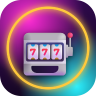
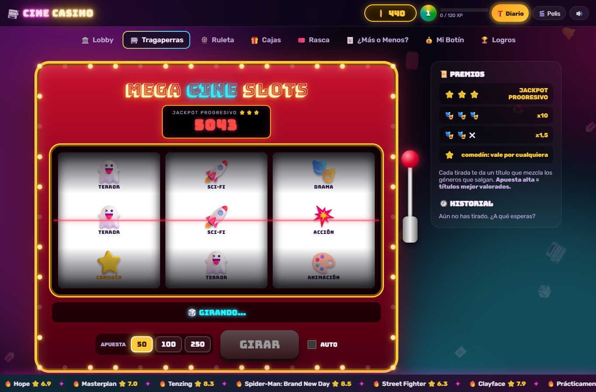

# Cine Casino

**¿Media hora decidiendo qué ver y al final repites la de siempre?**
Tira de la palanca, gira la ruleta o rasca un boleto: el premio es tu próxima película o serie.

[🎰 **Jugar ahora**](https://cinecasino.github.io/web/) · [ℹ️ Qué es](https://cinecasino.github.io/web/landing/) · [🐞 Reportar un problema](https://github.com/cinecasino/web/issues/new/choose)

### Qué es

Cine Casino es una web de juegos de casino **sin dinero real** para descubrir películas y series. Cada jugada te da un título real, con sinopsis, tráiler y dónde verlo en España.

- 🎰 **Juegos:** tragaperras de géneros, ruleta, cajas de botín, rasca y gana, ¿Más o Menos? y "Me siento con suerte".
- 💎 **Colección:** guarda lo que ganas en tu botín, con rarezas de Común a Mítica, y deja que la ruleta "¿Qué veo hoy?" elija por ti.
- 🏆 **Progreso:** fichas, niveles, 22 logros y un bonus diario.
- 📲 **App:** se instala en Android y en escritorio, y funciona sin conexión.
- 🛡️ **Sin registro ni rastreo:** tu partida vive en tu navegador. Sin cuentas, sin analítica, sin publicidad.

> Las fichas no se compran, no se venden y no se canjean por nada. Es un juego simulado.

### Estado

**Beta pública.** Puede haber fallos, y las partidas podrían reiniciarse antes de la versión final. Si encuentras algo raro o tienes una idea, [ábrela aquí](https://github.com/cinecasino/web/issues/new/choose).

### Repositorios

| | |
|---|---|
| [`web`](https://github.com/cinecasino/web) | La web completa: juegos, landing y app instalable. Hecha con Astro y publicada en GitHub Pages. |

---

Este producto usa la API de <a href="https://www.themoviedb.org">TMDB</a>, pero TMDB no lo respalda ni lo certifica. Datos de plataformas: JustWatch.
